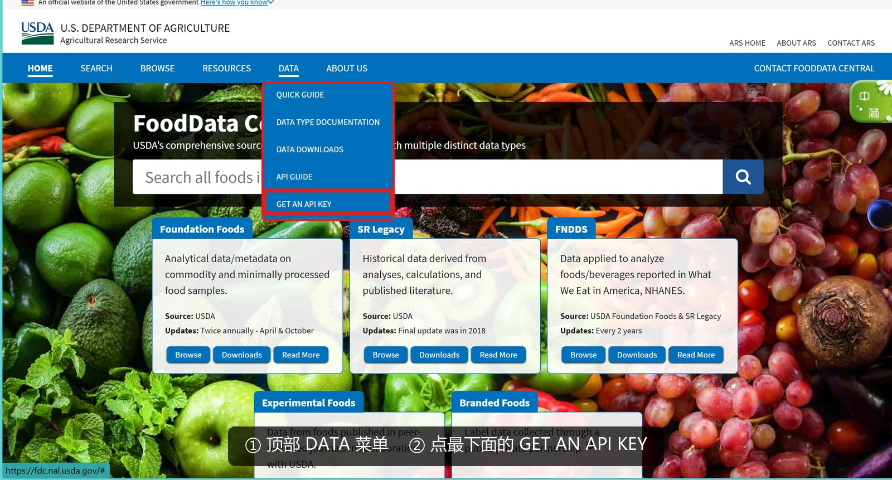

# 卜卜卡路里 · 多邻国式营养打卡

一个**双击就能打开**的单文件网页：输入食材、克数与烹饪方式，按《中国食物成分表》算出这一份真实的营养，按你自己的身高体重算出每日目标，给出缺口建议和每日 10 种食物推荐；打卡后胡萝卜吉祥物「卜卜」会跳出来，送你一条营养小知识。

## 怎么用

1. 双击 `index.html`（Chrome / Edge 均可），不需要服务器、不需要联网、不需要账号。
2. **第一次打开会先问你**：性别、年龄、身高、体重、活动量、目标（减脂 / 保持 / 增肌），然后按你的数据算出每日目标。
3. 「记录」页搜索食材（支持中文名与括号里的别名）→ 选克数 → 选做法（卡片上直接写缩水率和用油量）→ 看结果 → 加入今日。
4. 「今日」页看进度环与任务，记满一天后点「完成今日打卡」，卜卜出场 + 随机营养小知识。
5. 「分析」页看 25 项营养素的达标情况、膳食宝塔和今天吃到的特殊营养素。
6. 自测页：打开 `index.html#selftest`，会跑 72 条断言并显示通过情况。

## 分享给朋友

**直接把 `index.html` 发给对方就行**（微信文件、邮件、网盘都可以），不用安装、不用注册。

- 对方第一次打开会看到同一个 5 步引导，填他自己的性别 / 年龄 / 身高 / 体重 / 活动量 / 目标，之后就是一份**独立的记录本**。
- 每个人的档案和打卡数据只保存在**自己的浏览器** localStorage 里，互不影响；你继续用你的，什么都不用改。
- 食物库、USDA KEY、引导逻辑都随文件走；**USDA KEY 不随文件分享**，朋友要用联网补全得自己申请一个填进去。
- ⚠️ **手机微信里直接点 HTML 文件会显示成文件，不会打开网页**。要么让对方在电脑上双击打开，要么先把文件存到手机（文件管理器 / 网盘 App），再用手机浏览器打开。
- 换电脑、清理浏览器数据前，到「设置 → 分享给朋友」点 **导出我的备份**；到新设备后用 **导入备份** 还原。备份里不含 USDA KEY。

## 在线访问（GitHub Pages）

仓库地址：<https://github.com/liter112/bubu-calorie>

如果开启了 GitHub Pages，网页地址是：**<https://liter112.github.io/bubu-calorie/>**（手机也能直接打开）。

开启方法（只需要做一次）：

1. 打开仓库 → 点 **Settings**
2. 左侧菜单找到 **Pages**
3. **Source** 选 `Deploy from a branch`
4. **Branch** 选 `main`，目录选 `/ (root)` → 点 **Save**
5. 等 1–2 分钟，访问上面的网址就行

> - 免费账号的 Pages 只对 **Public** 仓库开放。如果仓库是 Private，需要先改成 Public（Settings → General → 最下面 Change visibility），或者升级 GitHub Pro。
> - **页面公开 ≠ 数据公开**：每个人的身高体重、打卡记录只保存在自己浏览器的 localStorage 里，别人打开链接看到的是空白的初始状态。

## 更新后如何同步到 GitHub

改了文件只是改了**本地**；只有「提交 + 推送」到 GitHub，别人下载到的才是新版本。如果开了 Pages，推送后 1 分钟内网页也会自动更新。

### 方式一：双击 `同步到GitHub.bat`（推荐，最省事）

仓库根目录有个 **`同步到GitHub.bat`**，双击它就会自动完成：

1. 用 python 重新打包 `index.html`（没装 python 会跳过并提示）
2. 把改动提交到本地（会让你写一句更新说明，直接回车用默认的日期时间）
3. 拉取远端最新（避免冲突）→ 推送到 GitHub

看到 **「完成！GitHub 上的文件已更新」** 就成功了。出错会停住并显示原因，把提示截图发我即可。

### 方式二：GitHub Desktop（图形界面）

1. 安装 <https://desktop.github.com/>，用你的 GitHub 账号登录
2. `File → Add local repository`，选择 `D:\food`
3. 左下角填一句说明（例如「更新 README」），点 **Commit to main**
4. 点右上角的 **Push origin**
5. 以后每次动手前，先点 **Fetch origin → Pull**（把别人的改动拉下来）

### 方式三：命令行

```powershell
cd D:\food
python build.py            # 只有改了 src/ 或样式才需要，重新生成 index.html
git add -A
git commit -m "更新说明"
git push
```

- 首次使用要先配置身份（只做一次）：
  ```powershell
  git config --global user.name "你的名字"
  git config --global user.email "你的邮箱"
  ```
- 推送时如果弹出登录窗口，密码要填 **Personal Access Token**（GitHub 已经不支持账号密码）：
  GitHub 头像 → Settings → Developer settings → Personal access tokens → **Tokens (classic)** → Generate new token → 勾选 `repo` → 复制生成的串当密码。
  这台电脑已经用 Git Credential Manager 记住过凭据，通常不会再问。

### 方式四：网页上传（只改一两个文件时）

GitHub 仓库页 → **Add file → Upload files** → 把文件拖进去 → **Commit changes**。

> 注意：网页上传只更新你拖上去的那个文件，**不会重新打包 `index.html`**。如果改的是 `src/`，还是要在本地跑 `python build.py` 再上传整个文件。

### 常见问题

| 现象 | 原因与处理 |
|---|---|
| `rejected ... non-fast-forward` | 远端比你新，先 `git pull --rebase` 再 `git push`（bat 已经自动做了这步） |
| `Authentication failed` | 凭据过期，按上面的 Personal Access Token 步骤重新登录一次 |
| 提交成功但网页没变 | 浏览器缓存，按 `Ctrl + F5` 强刷；如果开了 Pages，再等 1 分钟构建 |
| 不确定要提交什么 | 先 `git status` 看改动列表，确认没把临时文件带进去 |
| 改坏了想回退 | GitHub 网页上打开那个文件 → History → 选旧版本 → 复制内容改回来 |
| 单个文件超过 100 MB | GitHub 会拒绝推送，需要拆分成多个文件 |

### 更新前的小检查

1. 改了 `src/` 或样式 → 先 `python build.py`，否则 `index.html` 不是最新的
2. 打开 `index.html#selftest` 跑一遍自测，确认全部通过
3. 再提交推送

## 你的档案与目标

首次引导里填什么就按什么算；之后随时可以在「设置 → 我的档案」改（含性别、目标），保存后立即重算。

支持三种目标：

| 目标 | 热量 | 蛋白质 |
|---|---|---|
| 减脂 | TDEE − 250/400/500 kcal（不低于下限） | 1.25 g/kg |
| 保持 | = TDEE | 1.0 g/kg |
| 增肌 | TDEE + 200/300 kcal | 1.6 g/kg |

热量下限：女 1200 kcal、男 1500 kcal。脂肪取 25%E（最低 25 g），碳水取余量（最低 100 g）。

以「19 岁 / 女 / 156.5 cm / 64 kg / 轻度活动 1.375 / 减脂缺口 500」为例：

| 项目 | 目标 |
|---|---|
| 能量 | 1373 kcal（BMR 1362 × 1.375 = TDEE 1873 − 500） |
| 蛋白质 | 80 g（1.25 g/kg） |
| 脂肪 | 38 g（25%E） |
| 碳水 | 178 g（余量） |
| 膳食纤维 | 25 g |
| 糖 / 钠 | ≤25 g / ≤2000 mg |

维生素矿物质按《中国居民膳食营养素参考摄入量（2023）》按**性别与年龄**取值：

| 营养素 | 男 | 女 |
|---|---|---|
| 铁 | 12 mg | 18 mg（50 岁以上 12 mg） |
| 锌 | 12.5 mg | 7.5 mg |
| 维生素 A | 800 µgRAE | 700 µgRAE |
| 维生素 B1 / B2 | 1.4 mg | 1.2 mg |
| 烟酸 | 15 mgNE | 12 mgNE |
| 胆碱 | 500 mg | 400 mg |
| 钙 | 800 mg（14–17 岁、50 岁以上 1000 mg） | 同左 |

孕期、哺乳期、慢性病或进食障碍史请咨询医生或注册营养师，本页不能替代专业建议。

## 烹饪换算模型

```
熟重 = 生重 × 熟制率
用油 = 选择的做法默认 g/100g × 生重/100（可手动覆盖）
热量 = 生重营养 × 留存率 + 油 × 8.99 kcal/g + 附加糖 × 4 kcal/g
```

- 16 种做法：生食、破壁打汁、凉拌、焯水、水煮、蒸、微波、快炒、爆炒、煎、空气炸、油炸、烤、炖、红烧、高压锅。
- **破壁打汁**与生食口径一致：重量不变、用油 0、营养留存 100%。它会提示：破壁只是把膳食纤维切碎，总纤维与碳水总量不变，但纤维网状结构被破坏，糖分吸收更快、升糖反应高于整块食用。
- 每种做法按食材类别给出缩水率（叶菜爆炒约缩 38%）、用油量（爆炒 6 g/100 g）和水溶性维生素留存率；水煮还会计算钾等矿物质的溶出。
- 谷类遇到「水煮/蒸」按吸水增重 2.2 倍计算；已经煮熟的米饭、馒头、面条会自动识别，不会重复吸水。
- 红烧默认附加 5 g 糖/100 g、0.8 g 盐/100 g，可在记录页关掉。

以上都是文献常见区间的中值，**属于参考值**，实际取决于锅具、火候和食材含水量。

## 数据来源

- **《中国食物成分表》标准版（第 6 版）**「能量和一般营养成分」表，共约 1677 行公开转换数据（来源：GitHub `Sanotsu/china-food-composition-data`），入库 1657 条。**仅个人自用，请勿再分发。**
- **USDA FoodData Central** 补充了 14 种中国成分表未收录的常见食材（蓝莓、牛油果、藜麦、鹰嘴豆、奇亚籽、希腊酸奶、燕麦片、全麦面包、彩椒、芦笋、车厘子、石榴、巴旦木、沙丁鱼），标注 `src:"USDA"`、`est:true`。
- 第 6 版不含**糖、维生素 B6/B12、叶酸、维生素 D/K、碘、胆碱**，这些字段统一为 `null`，界面显示「未收录」，不会当成 0 参与达标计算。填了 USDA KEY 后可联网补全。
- 质检报告见 `data/qc-report.md`：21 条「能量-宏量偏差 >30%」的条目已列出，使用时请留意。

## 食材库管理（设置页）

上传的自定义食材**只存在于本次打开的内存里**，刷新页面即恢复内置库；打卡记录与食材库完全独立，历史记录保存的是营养快照，换库不会改变历史。

- **追加食材**：按 `name` 去重，不覆盖已有食材。
- **全量替换**：本次生效的库 = 上传的 JSON（仅内存）。
- **导出当前库**：把内置 + 自定义的当前完整库下载为 JSON。
- **恢复内置库**：丢弃所有自定义内容。

JSON 格式（与导出文件一致）：

```json
[
  {
    "name": "胡萝卜",
    "cat": "rootVeg",
    "per100": { "kcal": 39, "protein": 1.0, "fat": 0.2, "carb": 8.8, "fiber": 1.1 }
  }
]
```

字段说明见 [`data/foods-schema.md`](data/foods-schema.md)。校验规则：必须是数组、`name` 非空、`per100.kcal` 为 0–950 的数字；其余字段可省略或为 `null`；`cat` 必须是内置类别之一。

## USDA 联网补全（可选，默认关闭）

内置的 1657 条数据已经够日常用了。如果想吃本地库里没有的食材（某些进口食品、国外品牌），可以免费申请一个 USDA 的 API KEY，让网页在本地查不到时自动去 USDA 查。

### 零基础申请 KEY（约 3 分钟）



1. 打开 <https://fdc.nal.usda.gov/>。不用注册也能浏览食物，但**调用 API 必须带 KEY**。
2. 鼠标移到顶部导航栏的 **DATA**，在下拉菜单里点最下面的 **GET AN API KEY**（就是上图红框的位置）。
3. 页面会跳到 api.data.gov 的注册页：填 **First Name（名）**、**Last Name（姓）**、**Email（邮箱）**，勾选同意条款，点 **Sign Up**。
   - 姓名用拼音或英文都可以，邮箱要填你能收到的。
   - 不需要信用卡，也不需要学校/公司邮箱。
4. 几秒后邮箱会收到一封标题类似 **"Your API key"** 的邮件，正文里那串 **40 位左右的字符**就是 KEY。
   - 没收到可以看垃圾邮件；也可以登录 <https://api.data.gov/>，在 **API Keys** 页面随时查看或重发。
5. 回到网页 → **设置 → USDA 联网补全** → 把 KEY 粘进输入框 → 勾选「开启联网查询」→ 点 **保存**。
6. 到「记录」页搜一个本地库没有的食材，搜索框下方会出现「用 USDA 查询」按钮，点它就能拿到 USDA 的数据。

### 注意事项

- **免费**，不用绑卡；限速约 **1000 次/小时**（按 IP 算），个人使用完全够。
- KEY 只存在你**本机的浏览器**里，不会上传到任何服务器；「导出备份」时也会自动剔除 KEY，所以分享 `index.html` 或备份文件都不会泄露。
- 浏览器直连 USDA 可能被 **CORS** 拦截，失败时页面会提示并自动回退内置数据，不影响主流程。
- 别把自己的 KEY 发到公开群或仓库里；万一泄露，回 api.data.gov 删掉重新申请一个即可。
- 如果哪天 USDA 改版找不到入口，可以直接访问 <https://fdc.nal.usda.gov/api-key-signup.html>。

## 打卡与游戏化

- 记录 1 种食物 +10 XP，完成打卡 +50 XP，完成每日任务各 +20 XP；等级 = `1 + floor(sqrt(XP/120))`。
- 连续天数按本地日期计算，断签归零但保留最佳纪录。
- 每日 3 个任务：记录 5 种食物 / 蔬果 ≥500 g / 蛋白质达标。
- 40 条营养小知识在打卡后随机抽取，同一轮内不重复。

## 开发

```
src/
  index.template.html     外壳（CSS/JS 占位符）
  styles/                 三个 CSS 文件
  js/data-foods.js        由 tools/build_foods.py 生成（勿手改）
  js/*.js                 其余模块
build.py                  把 src/ 内联成单文件 index.html
同步到GitHub.bat          双击：重新打包 + 提交 + 推送（GBK 编码）
docs/                     README 用的配图（USDA KEY 申请截图）
tools/build_foods.py      cfct-raw.json → data-foods.js + qc-report.md
tools/make_usda_guide.py  给 USDA 截图加红框与说明，生成 docs/usda-api-step1.jpg
tools/make_sync_bat.py    重新生成「同步到GitHub.bat」
tools/dom-smoke.mjs       Node 里跑一遍页面逻辑（最小 DOM 垫片）
tools/migrate-test.mjs    老存档迁移 / 备份导入导出测试
tools/shoot.mjs           CDP 无头截图
```

改完源码后运行 `python build.py` 重新生成 `index.html`；想一步到位就用根目录的 `同步到GitHub.bat`。

```powershell
python build.py
node tools/dom-smoke.mjs     # 自测断言 + 各页面渲染不报错
node tools/migrate-test.mjs  # 老用户升级 / 备份导入导出
```

## 已知限制

- 营养数据为典型值，品种、产地、部位不同可能有 ±20% 的波动；烹饪缩水率与吸油量也是中值估计。
- 本页是自我管理的饮食记录工具，**不构成医疗或营养治疗建议**。有慢性病、孕期、进食障碍史等情况请咨询医生或注册营养师。
- 食材库来自公开转换版，个别条目可能存在识别误差，以 `qc-report.md` 标注的为准。
